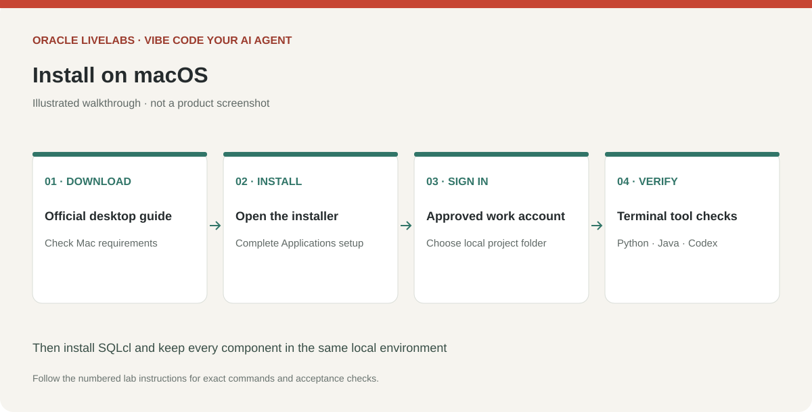
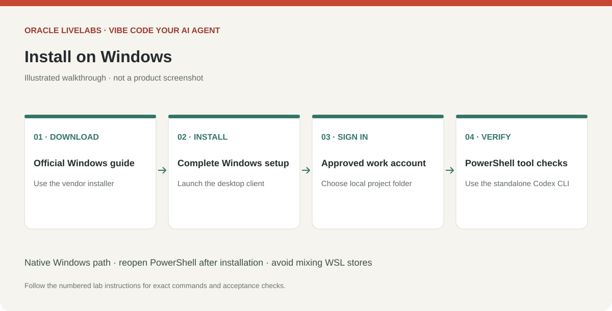

# Install ChatGPT and Codex on your client

## Introduction

Install the desktop experience and a reproducible terminal path for MCP configuration. Use local execution in the same operating-system environment as SQLcl. A hosted chat does not automatically see your laptop's wallet or Codex configuration.

Estimated Time: 25 minutes, excluding software downloads.

### Objectives

* Install and sign in on Windows or macOS.
* Verify Python, Java, SQLcl and the standalone Codex CLI.
* Open an isolated project in Codex.

### Prerequisites

An approved account, installation rights, and a supported client. Follow your organization's software-distribution process where required.

Complete Task 1 **or** Task 2 for your operating system, then complete Tasks 3 and 4.

## Task 1: Install on macOS

1. Open the [official desktop guide](https://learn.chatgpt.com/docs/app) and follow its download link. Confirm the current hardware and OS requirements, download the Mac installer, open it, and complete the installation. If the installer shows an Applications folder target, drag the app there, then launch ChatGPT from Applications. Sign in with your approved account.

    

    > *Screenshot placeholder — Download ChatGPT on macOS, complete installation, and open the signed-in local workspace.*

2. Open the local coding workspace available in your installed release and select a project folder. Product labels may change; the terminal route below is the common workshop path if the desktop coding workspace is unavailable. Installing the chat app alone does not register a database MCP server.

3. Install Python 3.11+ from [Python](https://www.python.org/downloads/macos/) and a supported JDK from [Oracle Java](https://www.oracle.com/java/technologies/downloads/), using their macOS installers. Open Terminal, verify those tools, and install the standalone Codex CLI using the official installer:

    ```bash
    <copy>
    python3 --version
    java -version
    curl -fsSL https://chatgpt.com/codex/install.sh | sh
    </copy>
    ```

4. Open a new Terminal window so the installer's PATH changes take effect. Verify Codex and create the workspace. Use one folder per project and keep wallet files elsewhere.

    ```bash
    <copy>
    codex --version
    mkdir -p ~/vibe-agent-lab
    cd ~/vibe-agent-lab
    codex
    </copy>
    ```

    Complete the sign-in flow offered by Codex. If the desktop app is not supported on this Mac, continue with Codex CLI if its current requirements support your machine.

## Task 2: Install on Windows

1. Open the [official Windows guide](https://learn.chatgpt.com/docs/windows/windows-app), follow its download link, complete the installer, launch ChatGPT, and sign in. Use a native local Windows workspace for this lab.

    

    > *Screenshot placeholder — Complete the Windows installer and open the signed-in local workspace.*

2. Install Python 3.11+ from [Python](https://www.python.org/downloads/windows/) and a supported JDK from [Oracle Java](https://www.oracle.com/java/technologies/downloads/) using their Windows installers. Include Python's launcher/PATH option if offered. Close and reopen PowerShell, then verify those tools and run the official standalone Codex installer:

    ```powershell
    <copy>
    py -3 --version
    java -version
    irm https://chatgpt.com/codex/install.ps1 | iex
    </copy>
    ```

3. Open a new PowerShell window, verify Codex, and create the project:

    ```powershell
    <copy>
    codex --version
    New-Item -ItemType Directory -Force "$env:USERPROFILE\vibe-agent-lab"
    Set-Location "$env:USERPROFILE\vibe-agent-lab"
    codex
    </copy>
    ```

    Complete Codex sign-in. Native Windows and WSL have different paths and credential stores. If you choose WSL, install every component and wallet inside that environment and translate all paths; do not mix the two.

## Task 3: Install Oracle SQLcl

1. Download SQLcl from [Oracle SQLcl Downloads](https://www.oracle.com/database/sqldeveloper/technologies/sqlcl/download/). Use a release with MCP support, SQLcl 25.2 or later, and check that release's Java requirements. The original MCP prerequisites specify Java 17+; newer SQLcl distributions may require a newer JDK. Install the matching JDK, not an arbitrary older one.

2. Extract the archive to a stable path, for example `/Users/YOUR_USER/tools/sqlcl` on Mac or `C:\Tools\sqlcl` on Windows. Verify the executable directly:

    macOS:

    ```bash
    <copy>
    "$HOME/tools/sqlcl/bin/sql" -version
    "$HOME/tools/sqlcl/bin/sql" /nolog
    </copy>
    ```

    Windows PowerShell:

    ```powershell
    <copy>
    & "C:\Tools\sqlcl\bin\sql.exe" -version
    & "C:\Tools\sqlcl\bin\sql.exe" /nolog
    </copy>
    ```

    Use the actual executable supplied by your SQLcl distribution. Exit with `exit`. Record installed versions in your local workshop notes.

## Task 4: Verify the client checkpoint

1. In Codex, send this prompt:

    ```text
    <copy>
    Confirm the current working directory and operating system. Do not read
    credential files. Create a short local README describing this as a Python
    application workspace for an approved Oracle database. Do not connect yet.
    </copy>
    ```

2. Confirm the file appears in the intended project. Continue only when your terminal can launch both Codex and SQLcl. Retain normal approval controls; approve specific setup operations when you understand them.

    > *Screenshot placeholder — Open the project folder in Visual Studio Code, launch Codex in the integrated terminal, and show the generated README in the Explorer.*

## Learn More

* [Codex CLI installation and sign-in](https://learn.chatgpt.com/docs/codex/cli)
* [Original SQLcl MCP prerequisites](https://docs.oracle.com/en/database/oracle/sql-developer-command-line/25.2/sqcug/preparing-your-environment.html)

## Acknowledgements

* Prepared for the analytics-ai workshop maintainers.
* Last updated: November 6, 2026.
