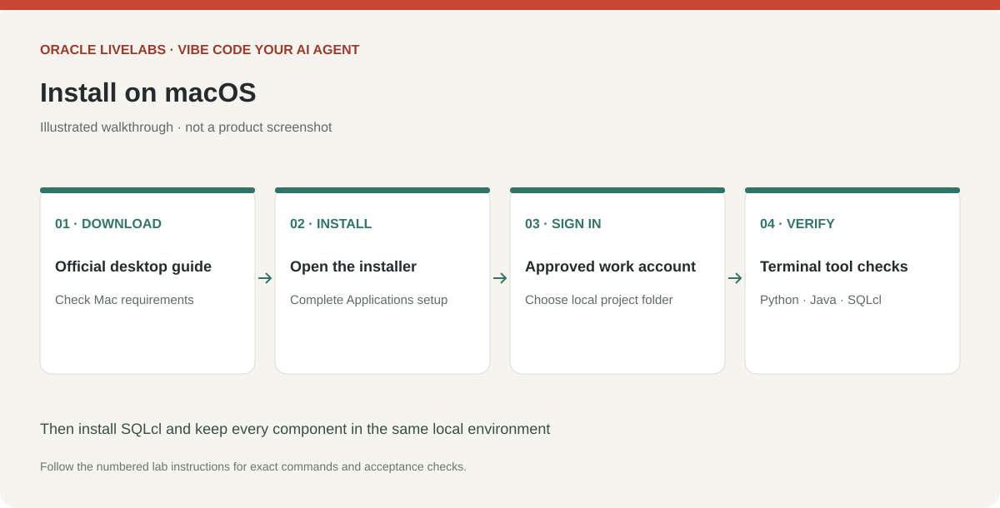
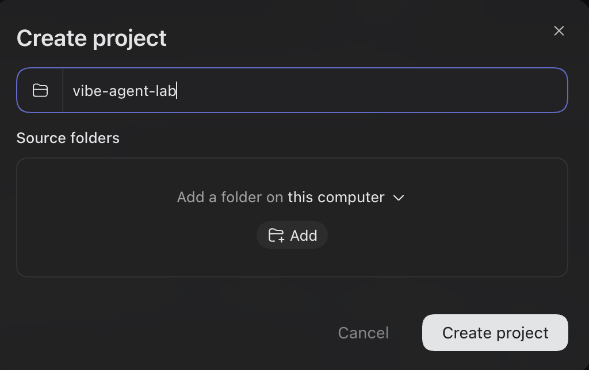
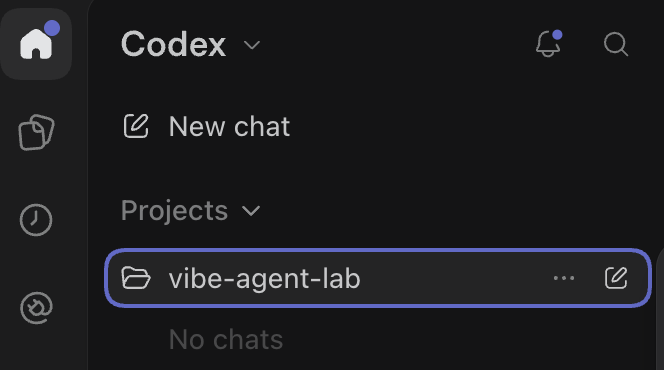
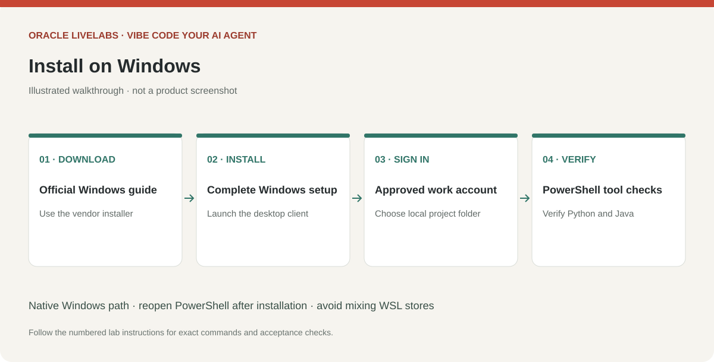
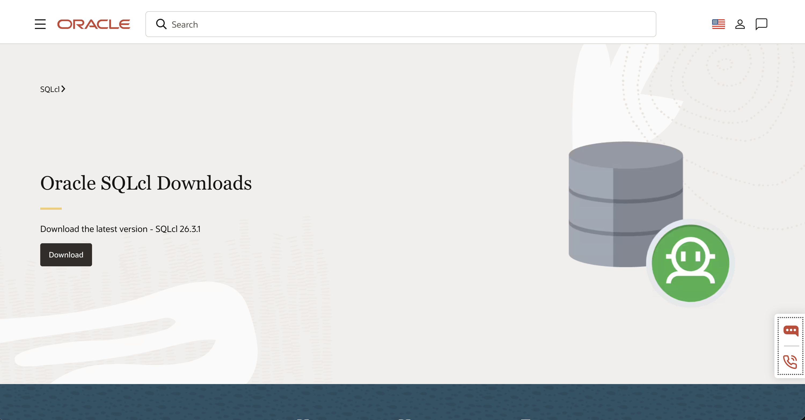
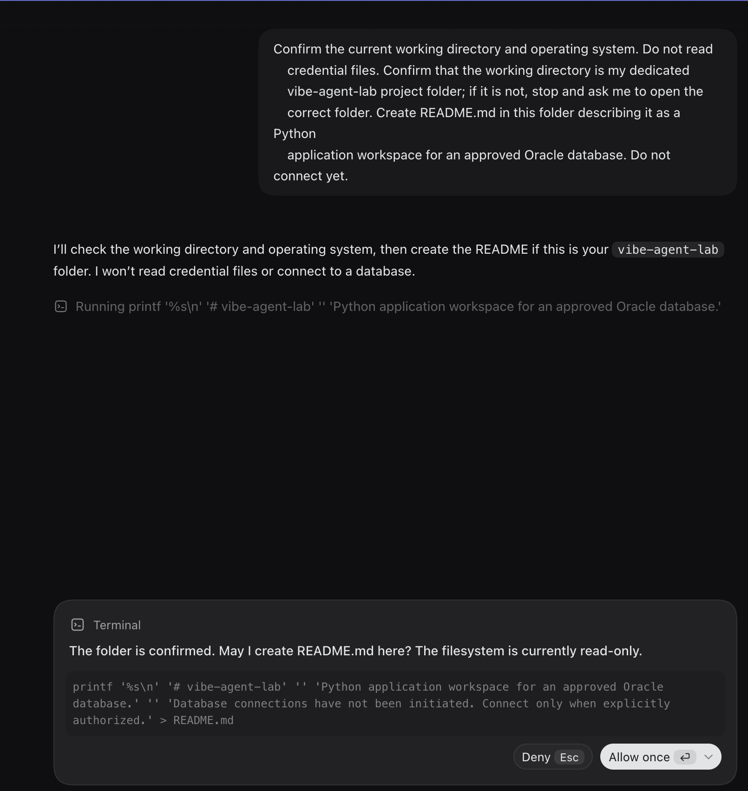
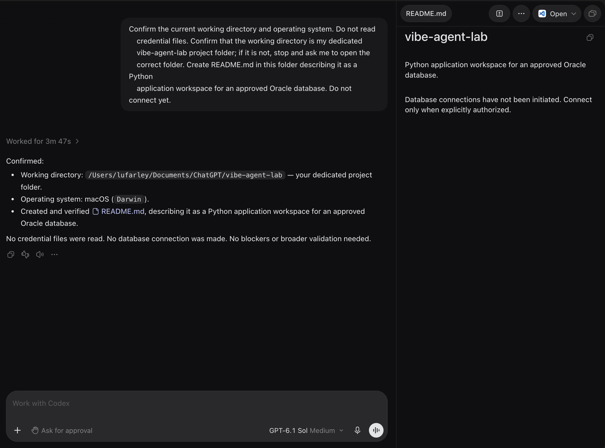
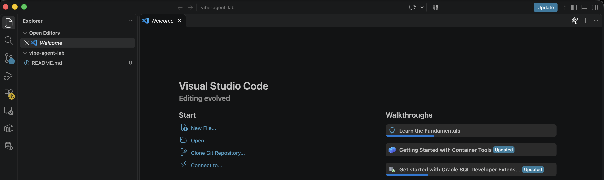
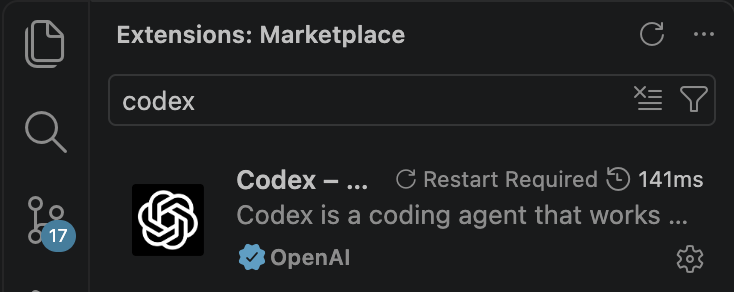
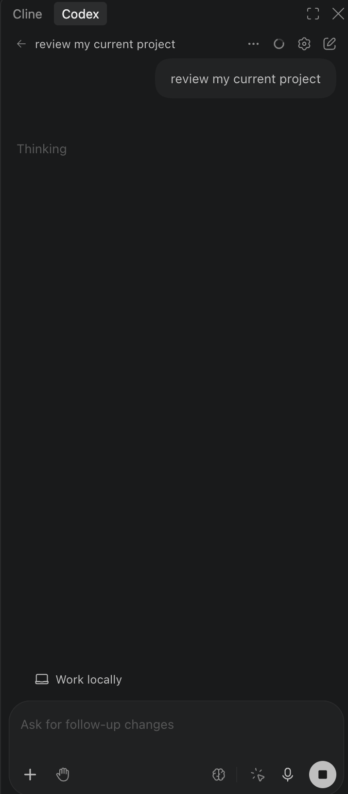

# Install ChatGPT and Codex on your client

## Introduction

Use Codex in the desktop client to create a local project and work through the workshop prompts. Use Terminal or PowerShell for installing and verifying dependencies, setting up SQLcl connections, and running the generated app. Keep these tools in the same operating-system environment. A hosted chat does not automatically see your laptop's wallet or local MCP configuration.

Estimated Time: 25 minutes, excluding software downloads.

### Objectives

* Install and sign in on Windows or macOS.
* Verify Python, Java and SQLcl.
* Open a dedicated local project and chat in Codex desktop.

### Prerequisites

An approved account, installation rights, and a supported client. Follow your organization's software-distribution process where required.

Complete Task 1 **or** Task 2 for your operating system, then complete Tasks 3 and 4. Task 5 is optional.

## Task 1: Install on macOS

1. Open the [official desktop guide](https://learn.chatgpt.com/docs/app) and follow its download link. Confirm the current hardware and OS requirements, download the Mac installer, open it, and complete the installation. If the installer shows an Applications folder target, drag the app there, then launch ChatGPT from Applications. Sign in with your approved account.

    

    > *Screenshot placeholder — Download ChatGPT on macOS, complete installation, and open the signed-in local workspace.*

2. Open Codex in the desktop client and create a new local project named **vibe-agent-lab**. Installing the chat app alone does not register a database MCP server.

    

    Record the project's actual folder location. In the illustrated setup it is `/Users/YOUR_USER/Documents/ChatGPT/vibe-agent-lab`; your location may differ. Use this same folder throughout the workshop and keep database wallets outside it.

    Create a new chat in this project with local execution selected.

    


3. Install Python 3.11+ from [Python](https://www.python.org/downloads/macos/) and a supported JDK from [Oracle Java](https://www.oracle.com/java/technologies/downloads/), using their macOS installers. Open Terminal and verify those tools:

    ```bash
    <copy>
    python3 --version
    java -version
    </copy>
    ```


## Task 2: Install on Windows

1. Open the [official Windows guide](https://learn.chatgpt.com/docs/windows/windows-app), follow its download link, complete the installer, launch ChatGPT, and sign in. Use a native local Windows workspace for this lab.

    

    > *Screenshot placeholder — Complete the Windows installer and open the signed-in local workspace.*

2. Install Python 3.11+ from [Python](https://www.python.org/downloads/windows/) and a supported JDK from [Oracle Java](https://www.oracle.com/java/technologies/downloads/) using their Windows installers. Include Python's launcher/PATH option if offered. Close and reopen PowerShell, then verify those tools:

    ```powershell
    <copy>
    py -3 --version
    java -version
    </copy>
    ```

3. Open Codex in the desktop client and create a new local project named **vibe-agent-lab**. Record its actual folder location and create a new chat in that project with local execution selected. Keep wallets outside the project. The standalone Codex CLI is not required for this workshop.

    Use native Windows execution for this walkthrough. SQLcl, Java, Python and the desktop project's local agent must use the same Windows environment. WSL has separate paths and credential stores; do not mix a WSL agent with the native Windows SQLcl setup shown here.

## Task 3: Install Oracle SQLcl

1. Download SQLcl from [Oracle SQLcl Downloads](https://www.oracle.com/database/sqldeveloper/technologies/sqlcl/download/). Use a release with MCP support, SQLcl 25.2 or later, and check that release's Java requirements. The original MCP prerequisites specify Java 17+; newer SQLcl distributions may require a newer JDK. Install the matching JDK, not an arbitrary older one.

    

2. Create the `tools` directory, copy the downloaded ZIP there, and extract it into that same directory. The archive creates the `sqlcl` subdirectory for you. Complete the steps for your operating system. Replace `sqlcl-YOUR_VERSION.zip` with the exact filename in your Downloads folder.

    macOS — open Terminal and run:

    ```bash
    <copy>
    mkdir -p "$HOME/tools"
    cp "$HOME/Downloads/sqlcl-YOUR_VERSION.zip" "$HOME/tools/sqlcl.zip"
    unzip "$HOME/tools/sqlcl.zip" -d "$HOME/tools"
    </copy>
    ```

    Windows — open PowerShell and run:

    ```powershell
    <copy>
    New-Item -ItemType Directory -Force "C:\Tools"
    Copy-Item "$env:USERPROFILE\Downloads\sqlcl-YOUR_VERSION.zip" "C:\Tools\sqlcl.zip"
    Expand-Archive -Path "C:\Tools\sqlcl.zip" -DestinationPath "C:\Tools"
    </copy>
    ```

3. Verify the executable directly:

    macOS:

    ```bash
    <copy>
    "$HOME/tools/sqlcl/bin/sql" -version
    "$HOME/tools/sqlcl/bin/sql" /nolog
    </copy>
    ```

    Windows PowerShell:

    ```powershell
    <copy>
    & "C:\Tools\sqlcl\bin\sql.exe" -version
    & "C:\Tools\sqlcl\bin\sql.exe" /nolog
    </copy>
    ```

    Use the actual executable supplied by your SQLcl distribution. Exit with `exit`. Record installed versions in your local workshop notes.

## Task 4: Verify the client checkpoint

1. Use the dedicated `vibe-agent-lab` project folder created in Task 1 or Task 2. This is the application workspace for the rest of the workshop; it is separate from the SQLcl installation in `tools/sqlcl`. Select this project and its local chat in the desktop client before sending prompts. Use the folder location you recorded earlier; there is no requirement to create a second project under your home directory.

2. In the project's Codex desktop chat, send this prompt:

    ```text
    <copy>
    Confirm the current working directory and operating system. Do not read
    credential files. Confirm that the working directory is my dedicated
    vibe-agent-lab project folder; if it is not, stop and ask me to open the
    correct folder. Create README.md in this folder describing it as a Python
    application workspace for an approved Oracle database. Do not connect yet.
    </copy>
    ```

    

    Review the proposed file operation and approve it once. Keep normal approval controls enabled; review subsequent operations as they appear.

3. Confirm `README.md` appears inside `vibe-agent-lab`. Keep using this project folder for the remaining labs. Continue only when the desktop chat can work with files in this project and Terminal or PowerShell can launch SQLcl at its installed path. Retain normal approval controls; approve specific setup operations when you understand them.

    

    You can also open the generated README in Visual Studio Code using the desktop client's editor control. See optional Task 5 for editor setup.

## Task 5: Optional — Set up Visual Studio Code and the Codex extension

Visual Studio Code provides an editor for reviewing generated Python files, configuration, tests and changes. Neither VS Code nor its Codex extension is required to complete this workshop. The remaining labs continue in Codex desktop; some screenshots use VS Code for file review.

1. Download the installer for your operating system from [Visual Studio Code](https://code.visualstudio.com/download), follow the [official installation instructions](https://code.visualstudio.com/docs/setup/setup-overview), and launch the editor. If VS Code is already installed, use your existing installation.

2. Select **File → Open Folder** and open the same local `vibe-agent-lab` folder you created in Codex desktop. Use the actual path recorded in Task 1 or Task 2. Confirm that `README.md` appears in the Explorer. You do not need to create a second project or copy the files.

    

3. If you also want to use Codex inside the editor, follow the installation link in the [official Codex IDE extension guide](https://learn.chatgpt.com/docs/codex/ide). Install the **Codex** extension published by **OpenAI**. You can skip this step and use VS Code only as an editor.

4. Open the **Codex** sidebar. If the icon is not visible, open the Command Palette with **Cmd+Shift+P** on macOS or **Ctrl+Shift+P** on Windows and run **Codex: Open Codex Sidebar**. Complete sign-in with your approved account if prompted. Keep the same local project folder open.





5. Return to the project's Codex desktop chat to continue with Lab 2. You can keep VS Code open for file review. If you later choose to run workshop prompts in the extension, verify the project folder, MCP tools and database identity in that client before using database tools; Lab 3 covers those checks. Avoid running simultaneous edits to the same files from both clients.

## Learn More

* [Desktop installation and sign-in](https://learn.chatgpt.com/docs/app)
* [Desktop MCP server setup](https://learn.chatgpt.com/docs/extend/mcp)
* [Codex IDE extension setup](https://learn.chatgpt.com/docs/codex/ide)
* [Original SQLcl MCP prerequisites](https://docs.oracle.com/en/database/oracle/sql-developer-command-line/25.2/sqcug/preparing-your-environment.html)

## Acknowledgements

* Prepared for the analytics-ai workshop maintainers.
* Last updated: November 6, 2026.
