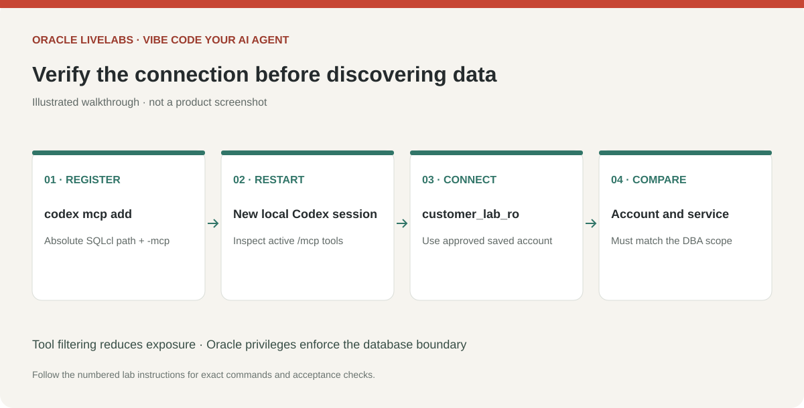

# Connect Codex to the Oracle SQLcl MCP server

## Introduction

Codex launches SQLcl as a local stdio MCP subprocess. It uses the saved connection created in Lab 2. You do not need a public endpoint, an HTTP proxy, or a custom server.

Estimated Time: 20 minutes.

### Objectives

* Add a SQLcl MCP entry to Codex.
* Verify tools and the intended database identity.
* Keep database permissions as the enforcement boundary.

### Prerequisites

A fresh-process saved connection test has passed. Codex and SQLcl run under the same OS user and environment.

If client database access is not ready, use Lab 4's metadata-export route for initial discovery and planning. Skip this lab's connection tasks until access is available. The export route does not provide live query validation or remove the finished app's need for database access.

## Task 1: Register the local MCP server

1. Close the current Codex terminal session and run one command in a normal terminal, replacing the executable with its absolute path.

    macOS:

    ```bash
    <copy>
    codex mcp add lab_db -- /Users/YOUR_USER/tools/sqlcl/bin/sql -mcp
    codex mcp list
    </copy>
    ```

    Windows PowerShell:

    ```powershell
    <copy>
    codex mcp add lab_db -- "C:\Tools\sqlcl\bin\sql.exe" -mcp
    codex mcp list
    </copy>
    ```

2. Inspect the generated entry in your user Codex configuration, `~/.codex/config.toml` on Mac or `$env:USERPROFILE\.codex\config.toml` on Windows. Back up existing configuration and merge only this entry; do not overwrite unrelated settings. Add the following options to its existing table:

    ```toml
    <copy>
    enabled_tools = ["connections_list", "connect", "disconnect", "sql_run", "schema_information"]
    startup_timeout_sec = 60
    tool_timeout_sec = 60
    </copy>
    ```

    An illustrative complete Mac entry is:

    ```toml
    [mcp_servers.lab_db]
    command = "/Users/YOUR_USER/tools/sqlcl/bin/sql"
    args = ["-mcp"]
    enabled_tools = ["connections_list", "connect", "disconnect", "sql_run", "schema_information"]
    startup_timeout_sec = 60
    tool_timeout_sec = 60
    ```

    For Windows, a TOML literal string avoids backslash escaping: `command = 'C:\Tools\sqlcl\bin\sql.exe'`. Confirm the actual advertised tool names for your SQLcl release. Excluding `sqlcl_run` reduces exposed capabilities, but `sql_run` can still execute writes or PL/SQL if the database permits them. The allowlist is not a read-only security control.

3. Start Codex again in the project. Enter `/mcp` and confirm that `lab_db` is connected and the intended tools are listed. A configured entry alone is not proof of a successful server handshake.

    

    > *Screenshot placeholder — Open the Codex MCP server list and show lab_db connected with its available tools.*

## Task 2: Verify the database identity

1. Send this prompt and approve only the intended tool operations:

    ```text
    <copy>
    Use only the lab_db MCP server. Connect only to the saved connection
    lab_reader. Verify SELECT USER and the current service name from DUAL.
    Show the connected account and service, then stop. Do not inspect other
    connections, read local secrets, or execute DDL, DML, PL/SQL or SQLcl commands.
    </copy>
    ```

2. Compare the identity with Lab 2. If it differs, disconnect and correct the saved connection. SQLcl's connection listing can expose the names of other saved connections. For this workshop, use a dedicated OS profile or SQLcl connection store containing only the approved lab connection, following your SQLcl release's supported configuration. The MCP alias is not a saved-connection allowlist.

    > *Screenshot placeholder — Show the approved account/service identity returned by the MCP check, with identifying values redacted.*

## Task 3: Use a desktop workspace if preferred

1. In desktop releases that expose **Settings → MCP servers**, add a **STDIO** server with the same absolute SQLcl command and `-mcp` argument, then restart the local workspace. Use the CLI route as the workshop baseline if your desktop release or organization policy does not expose this option. Do not assume a separate desktop runtime imports CLI settings.

2. Repeat the tool and identity checks in the actual workspace where you will build the app. A successful CLI test does not validate a different app runtime. Never paste this stdio configuration into a hosted chat's remote MCP URL field.

## Learn More

* [Codex MCP registration and configuration](https://learn.chatgpt.com/docs/extend/mcp?surface=cli)
* [Oracle SQLcl MCP launch configuration](https://docs.oracle.com/en/database/oracle/sql-developer-command-line/25.4/sqcug/starting-and-managing-sqlcl-mcp-server.html)
* [Oracle SQLcl MCP tool descriptions](https://docs.oracle.com/en/database/oracle/sql-developer-command-line/25.4/sqcug/sqlcl-mcp-server-tools.html)

## Acknowledgements

* Prepared for the analytics-ai workshop maintainers.
* Last updated: November 6, 2026.
