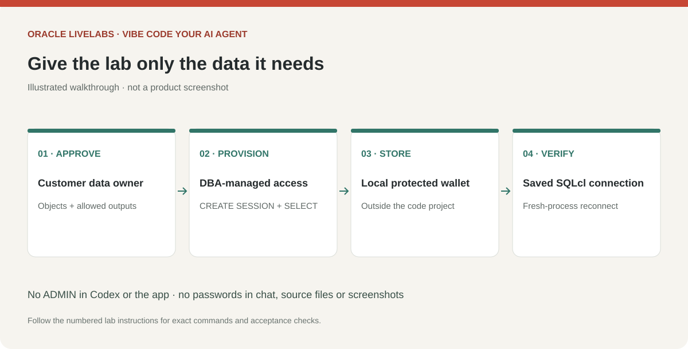

# Prepare access to your Autonomous AI Database

## Introduction

Create a dedicated least-privilege connection and verify it before adding AI tooling. The DBA completes access provisioning; the learner completes local wallet and connection setup.

Estimated Time: 25 minutes, excluding DBA and network changes.

### Objectives

* Scope the workshop to approved tables or views.
* Verify the client-to-database route and wallet.
* Save a SQLcl connection for noninteractive MCP use.

### Prerequisites

An existing database, DBA assistance, and customer approval for metadata and result sharing.

## Task 1: Agree the access scope with the DBA

1. Ask the DBA for a dedicated `LAB_READER` account, `CREATE SESSION`, and direct `SELECT` grants on only approved reporting views or tables. Do not grant broad roles, `SELECT ANY TABLE`, DDL or DML. Prefer masked aggregate views without personal data. Use a second similarly restricted account for the app when available.

    The following is a pattern for the DBA to adapt, not a learner copy/paste script. Replace the identifiers with real approved names and provision the password through the customer's normal secure process:

    ```sql
    grant create session to LAB_READER;
    grant select on APPROVED_OWNER.APPROVED_REPORTING_VIEW to LAB_READER;
    ```

2. Agree which schema names, comments and fields Codex may inspect. Object grants and read-only transactions enforce parts of the boundary; prompt instructions alone do not enforce permissions. Have the DBA check inherited roles and PUBLIC privileges too. A SELECT can invoke functions, so review the report SQL even for a restricted account.

    

## Task 2: Obtain the connection details and wallet

1. In the OCI Console, open your Autonomous AI Database and its **Database connection** page. If you lack wallet download permissions, have the DBA securely deliver the approved client wallet. Download an instance wallet using the approved workflow and retain its download password in your password manager.

2. Store the ZIP and extracted contents outside your project, for example `~/adb-wallets/customer-lab` or `C:\Users\YOUR_USER\adb-wallets\customer-lab`. Restrict the folder to your OS user. Do not upload the wallet to Codex or commit it. Python Thin mode needs `tnsnames.ora` and `ewallet.pem` from the extracted wallet.

3. Record the database username, an alias from `tnsnames.ora` such as `YOUR_DATABASE_low`, the wallet paths, and the approved owner/view names in private local notes. The wallet download password and the database account password are different credentials.

4. Confirm the route with the DBA. If a public endpoint uses an access control list, allow only the approved client egress address. For private endpoints, use the existing approved private route. Do not disable network controls to make the lab connect.

## Task 3: Save and test a SQLcl connection

1. Start SQLcl with `/nolog` as in Lab 1. Enter the following at the `SQL>` prompt, replacing paths, account and alias. Use the wallet ZIP for `cloudconfig`; Python will use the extracted directory later.

    ```sql
    set cloudconfig /Users/YOUR_USER/adb-wallets/customer-lab/Wallet_YOUR_DATABASE.zip
    connect -save customer_lab_ro -savepwd LAB_READER@YOUR_DATABASE_low
    ```

    On Windows use the actual Windows ZIP path, for example `C:\Users\YOUR_USER\adb-wallets\customer-lab\Wallet_YOUR_DATABASE.zip`. Quote paths containing spaces according to your installed SQLcl help. Enter the database password at SQLcl's password prompt, never in a shell command or chat. Check `help connect` if the installed release differs.

2. Verify the account and service:

    ```sql
    <copy>
    select user as CONNECTED_USER,
           sys_context('USERENV', 'SERVICE_NAME') as SERVICE_NAME
    from dual;
    connmgr list
    exit
    </copy>
    ```

3. Start a fresh SQLcl `/nolog` process and reconnect by saved name:

    ```sql
    <copy>
    connect -name customer_lab_ro
    select 1 as CONNECTION_OK from dual;
    exit
    </copy>
    ```

    Success means the connection works in a fresh process without reentering a database password or manually setting cloud configuration. If your SQLcl release does not retain the wallet association, edit the named connection with SQL Developer for VS Code's connection manager and save its wallet and password there; repeat this fresh-process test. Do not proceed until it passes. Saved passwords are required for SQLcl MCP's unattended connection, so protect the local connection store.

## Learn More

* [Oracle SQLcl wallet connection procedure](https://docs.oracle.com/en/cloud/paas/autonomous-database/serverless/adbsb/connect-sqlcl.html)
* [SQLcl saved connections for MCP](https://docs.oracle.com/en/database/oracle/sql-developer-vscode/26.3/sqdnx/configuring-database-connections.html)
* [Python Thin mode wallet requirements](https://python-oracledb.readthedocs.io/en/stable/user_guide/connection_handling.html#connecting-to-oracle-cloud-autonomous-databases)

## Acknowledgements

* Prepared for the analytics-ai workshop maintainers.
* Last updated: November 6, 2026.
