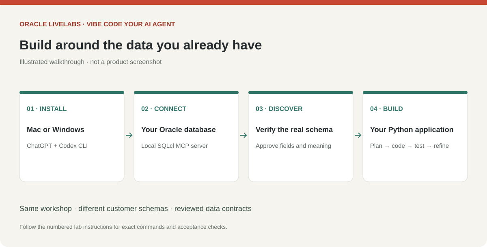
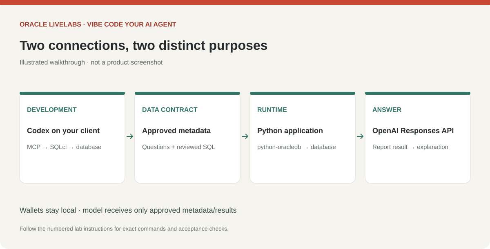

# Vibe code your own AI Agent Application on Autonomous AI Database

## About this Workshop

Build an application around the data you already have. You will give Codex a narrowly scoped Oracle connection, inspect the actual tables and fields, approve a plan, and iteratively create a local Python app. Your final app will answer business questions by choosing approved database reports and explaining the observed results.

Estimated Workshop Time: 3 hours 15 minutes, plus prerequisite installation and DBA provisioning.

### Objectives

* Install ChatGPT and a local Codex development environment on Windows or macOS.
* Connect the Oracle SQLcl MCP server to your Autonomous AI Database.
* Discover metadata without assuming a particular schema.
* Turn a business question into a reviewed application plan and report catalog.
* Build, test and run a Python UI with a real, bounded tool-calling agent.

### Prerequisites

* A supported Windows or Mac client, permission to install software, and internet access.
* An organization-approved ChatGPT/Codex account with access enabled. Check current account eligibility; this workshop makes no free-access guarantee.
* An existing Autonomous AI Database with approved tables or views, a DBA contact, and a working network route from your client. A private endpoint requires an approved VPN or other private route.
* Permission to send the selected metadata and aggregate results to the chosen AI service. Use sanitized views or a non-production copy if required by your organization.
* For the final app: an OCI compartment with permission to call OCI Generative AI, an approved OCI model/region with native tool calling, available service budget, and an approved local OCI authentication profile. Lab 6 covers setup. The local report viewer and database check can run without model calls.
* Python 3.11 or later, the standalone Codex CLI, and a supported JDK/SQLcl combination. Lab 1 covers installation.

## What you will build

> *Screenshot placeholder — Preview the finished app with two report views, a business question, an evidence-based answer and the expanded tool-activity panel.*

Your application contains a report browser, question input, evidence-based answers, and a visible tool activity panel. The model selects a report ID from a reviewed catalog. Application code runs its fixed SQL through python-oracledb and returns bounded results. The model does not receive an arbitrary SQL execution tool.

The development connection is `Codex → local SQLcl MCP → Autonomous AI Database`. The runtime connection is `Python → python-oracledb → database`, with selected report results passed to OCI Generative AI through the OCI Python SDK for the answer. Codex remains the development assistant; its account and data handling are separate from OCI runtime authentication. Neither local stdio MCP nor a local app URL needs to be published to the internet.

## Workshop choices

| Route | Best fit | Tradeoff |
| --- | --- | --- |
| SQLcl MCP, recommended for the full lab | Repeated live metadata inspection and report validation from Codex | Requires SQLcl/Java, a saved connection and a client network route |
| Approved metadata export | Initial discovery/planning when agent database access is unavailable | No live verification; the data owner must run SQL checks separately |

For the full live workflow, SQLcl MCP is the workshop recommendation because it provides an existing Oracle connector for both inspection and SQL checks. If you already use SQL Developer for VS Code, its connection manager can prepare the saved connection; Codex still needs its own MCP configuration. Choose the export route when avoiding connection setup is more valuable than immediate live validation.

This workshop connects an existing SQLcl MCP server. It does not require a custom MCP implementation or a hosted server. Start with approved aggregates and read access. Database administrator credentials are used only by the DBA during access setup, never by Codex or the application.

The workshop distributes prompts and inline planning outlines, not a completed application. You generate and review code locally in stages: connection check, two reports, interface, then agent and tests. Completion requires verifying two reports against trusted SQL results. If live MCP access is unavailable, use the metadata-export discovery route in Lab 4 and arrange SQL verification with the data owner.

## Learn More

* [OpenAI desktop documentation](https://learn.chatgpt.com/docs/app)
* [SQLcl MCP overview](https://docs.oracle.com/en/database/oracle/sql-developer-vscode/26.3/sqdnx/sqlcl-mcp-server.html)
* [Oracle Python connection documentation](https://python-oracledb.readthedocs.io/en/stable/user_guide/connection_handling.html)

## Acknowledgements

* Prepared for the analytics-ai workshop maintainers.
* Last updated: November 6, 2026.
