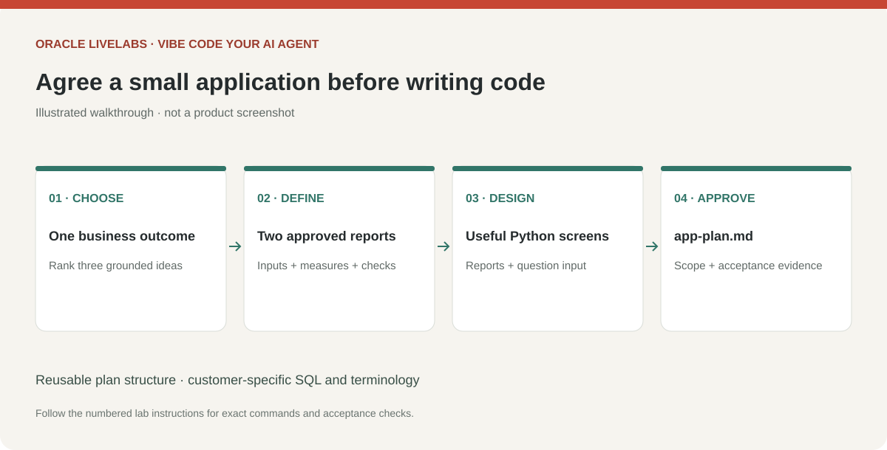

# Plan a Python application around your data

## Introduction

Plan a small, useful application before generating code. Start from your verified data map, whether you are working with inventory, operations, finance or another approved dataset.

Estimated Time: 15 minutes.

### Objectives

* Turn two business questions into report tools and screens.
* Define acceptance criteria and a bounded agent workflow.
* Approve the implementation plan before building.

### Prerequisites

An approved application brief and data map with resolved measure definitions.

## Task 1: Generate a sample application plan

1. Send the following prompt:

    ```text
    <copy>
    Read app-brief.md and data-map.md. Propose three small Python
    application ideas grounded only in verified objects. Rank by business value,
    access already available, and effort. Recommend one that answers two approved
    questions without new database objects. Use Streamlit, python-oracledb Thin
    mode, the OCI Python SDK and a bounded OCI Generative AI native tool-calling
    loop to be generated locally. Use the approved OCI model/region and IAM
    authentication profile. No arbitrary SQL tool.
    Write app-plan.md with these sections: Purpose and scope; Report catalog;
    Screens and agent behavior; Build milestones; Acceptance checks; Open questions.
    For every proposed
    report specify the business definition, exact source columns, filters, null
    handling, join assumptions and an independent SQL acceptance check. Identify
    missing facts and stop for review. Do not build or access data rows yet.
    </copy>
    ```

2. Use this example shape to assess the recommendation. Replace the report labels with concepts actually supported by your dataset:

    | Milestone | Sample deliverable | Acceptance evidence |
    | --- | --- | --- |
    | Connect | Local database status check | Restricted account and expected service |
    | First report | A current-state aggregate | Matches a trusted SQL result |
    | Second report | A time or category breakdown | Same grain, filters and units as the approved definition |
    | Interface | Your business terminology, two report views and question input | Data owner recognizes measures and labels |
    | Agent | Select report, run fixed SQL, explain results | Report ID, columns and real tool activity visible |
    | Verification | Supported, unsupported, empty and injection cases | No invented data, writes or secret disclosure |

    This is a planning pattern, not a promise that your schema has dates, categories or financial measures. Choose two different supported aggregates if a time series is unavailable.

    

    > *Screenshot placeholder — Review the three application ideas in Codex and open app-plan.md with the two proposed reports and screen layout.*

## Task 2: Approve the application contract

1. Review the proposed screens, two report definitions and excluded questions with the data owner. Limit the first version to two or three reports and approved output columns. Reject sensitive fields and unexplained joins. Record the approval locally without identifying information in public files.

2. Confirm that the model can only choose a registered report ID. The generated app owns SQL, credentials and row limits. Review its code to verify these boundaries before execution. Its agent loop is: receive question, select report tool, observe the returned evidence, and answer with the report source. Display these actions and observations; do not request or display private model reasoning.

3. Approve the plan in Codex using this prompt:

    ```text
    <copy>
    The reviewed app-plan.md is approved for its first two reports and
    screens. Record that scope and any unverified export-derived assumptions in
    the plan. We will generate the connection, reports, UI, agent and tests in
    stages in Lab 6. Do not implement or install anything until the next prompt.
    </copy>
    ```

    > *Screenshot placeholder — Review the final application scope and record plan approval before generating code.*

## Acknowledgements

* Prepared for the analytics-ai workshop maintainers.
* Last updated: November 6, 2026.
